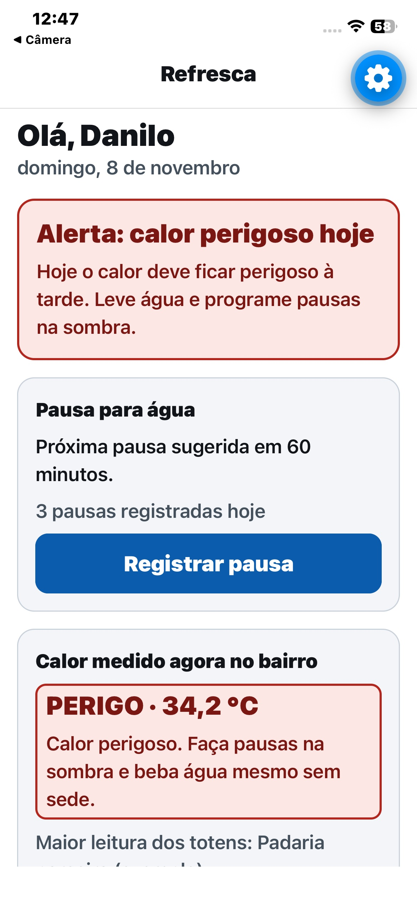
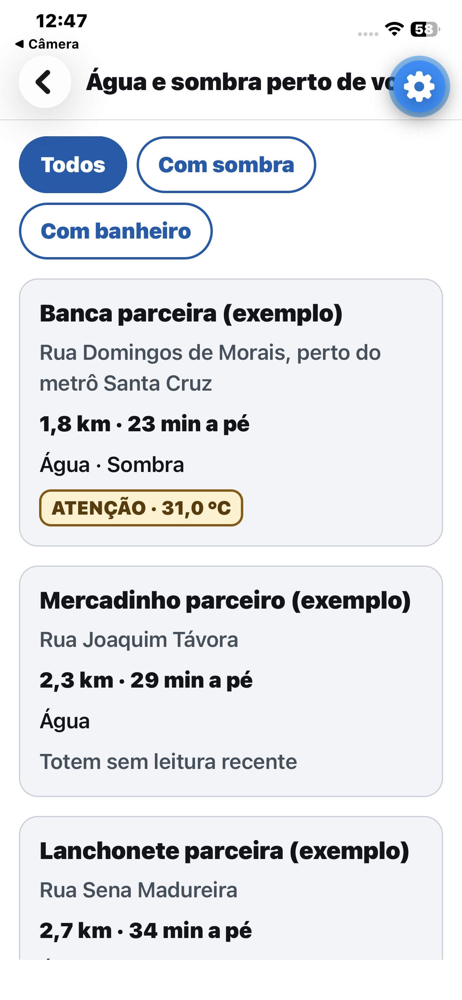
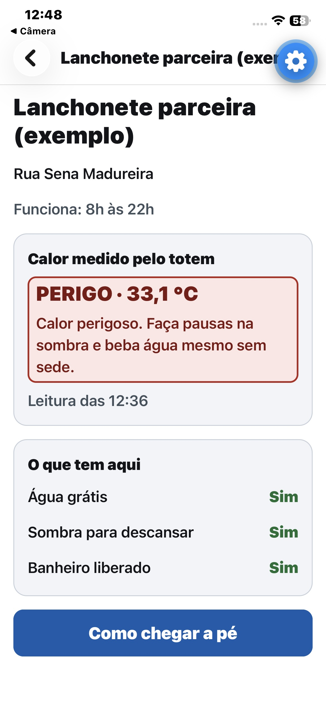
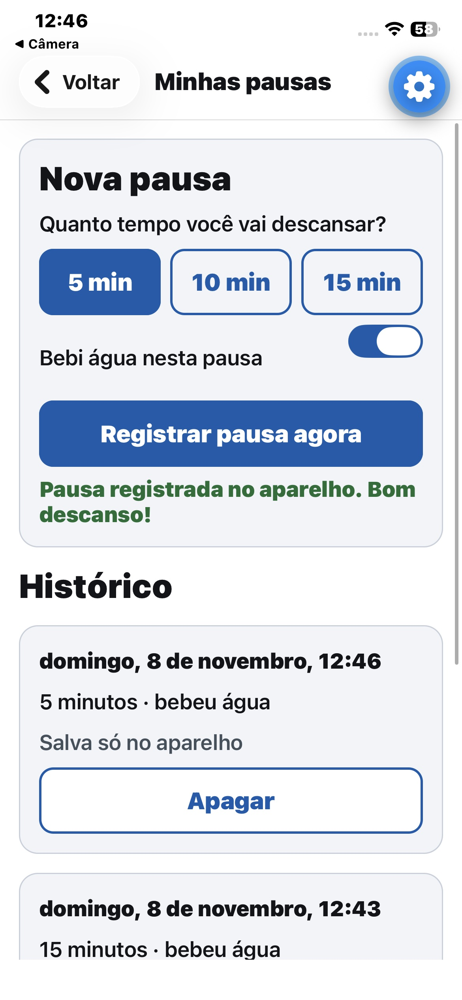
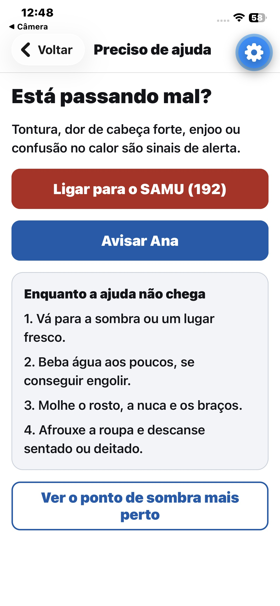
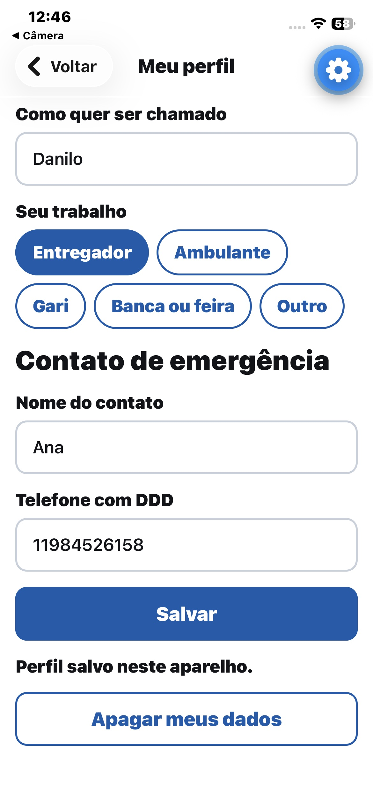
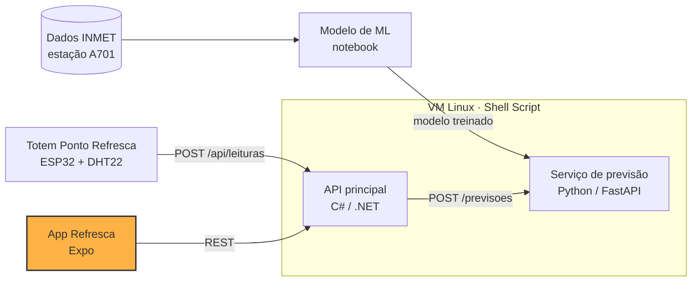

# Refresca · App do trabalhador

> Parte da CitizenTech **Refresca**, da Global Solution 2026.2 (FIAP, Engenharia de Software, 3º ano de Fev).
> Alertas de calor extremo e pontos de água e sombra para trabalhadores de rua da Vila Mariana.

**Disciplina:** Mobile Development & IOT

## Ficha da CitizenTech

| Campo | Conteúdo |
| --- | --- |
| **Nome** | Refresca |
| **Cidade e bairro** | São Paulo, Vila Mariana |
| **Cidadão beneficiado** | Trabalhador de rua: ambulante, entregador, gari, vendedor de banca |
| **Problema, em uma frase** | Trabalhadores de rua da Vila Mariana passam o dia expostos ao sol sem saber quando o calor fica perigoso, nem onde encontrar sombra e água por perto. |
| **Como funciona** | 1. Totens "Ponto Refresca" em comércios parceiros medem o índice de calor na rua e mostram um alerta colorido para quem passa. 2. Um modelo treinado com dados do INMET prevê se amanhã será um dia de calor perigoso. 3. O app avisa o trabalhador na véspera, mostra os pontos com água, sombra e banheiro mais próximos e lembra das pausas para hidratação. |
| **O que cada parte faz** | Ver [Repositórios da Refresca](#repositórios-da-refresca) |
| **Link do repositório** | https://github.com/danilowendler/Global-Solution-Refresca---Mobile |
| **Indicador de impacto** | Pausas de hidratação registradas no app em dias de alerta; % de alertas enviados antes do pico de calor; recall do modelo nos dias perigosos |
| **ODS conectados** | 3, 8, 10, 11 e 13 (detalhes abaixo) |

### Persona (fictícia)

Persona criada pela equipe a partir de informações públicas sobre trabalho de rua e calor. Não representa uma pessoa real nem uma entrevista realizada.

**Marcos, 34 anos, entregador de moto por aplicativo na Vila Mariana.** Passa cerca de 10 horas por dia na rua, esperando pedidos na calçada. Nos dias mais quentes sente dor de cabeça e tontura no fim da tarde. Compra água no comércio ou fica sem, quase não para porque perde corridas e tem pouco dado no celular pré-pago.

### Como os ODS são atendidos

- **ODS 3 · Saúde e bem-estar:** reduz o risco de exaustão e insolação ao antecipar dias perigosos e incentivar pausas e hidratação.
- **ODS 8 · Trabalho decente:** melhora as condições de trabalho de quem não tem posto fixo nem empregador que ofereça estrutura.
- **ODS 10 · Redução das desigualdades:** chega a quem tem pouco acesso a dados móveis, já que o totem funciona sem celular.
- **ODS 11 · Cidades sustentáveis:** transforma comércios do bairro em uma rede de pontos de apoio no espaço público.
- **ODS 13 · Ação contra a mudança do clima:** é uma ferramenta de adaptação a ondas de calor.

## Esta parte da Refresca

O app é a porta de entrada do trabalhador de rua. Ele mostra o alerta de calor do dia, a lista de Pontos Refresca mais próximos com água, sombra e banheiro, o calor medido pelos totens, lembra das pausas para hidratação e oferece um botão de ajuda que liga para o SAMU ou avisa um contato.

**Recebe dados de:** API principal em C# (alerta do dia, pontos e leituras dos totens).
**Envia dados para:** API principal em C# (pausas registradas).

### Jornada principal

1. Na tela **Hoje**, o trabalhador vê se o dia é de calor perigoso e quanto tempo falta para a próxima pausa.
2. Em **Água e sombra perto de você**, vê os pontos ordenados por distância, com o nível de calor de cada totem, e filtra por sombra ou banheiro.
3. No **detalhe do ponto**, confere o que tem ali e abre o caminho a pé no mapa do celular.
4. Em **Minhas pausas**, registra a pausa de hidratação. Ela fica salva no aparelho e é enviada para a API quando houver conexão.
5. Se passar mal, **Preciso de ajuda** liga para o 192 ou abre uma mensagem pronta para o contato de emergência.

### Telas

| Tela | Rota | Arquivo |
| --- | --- | --- |
| Hoje (alerta do dia) | `/` | `src/app/index.tsx` |
| Água e sombra perto de você | `/pontos` | `src/app/pontos/index.tsx` |
| Detalhe do ponto | `/pontos/[id]` | `src/app/pontos/[id].tsx` |
| Minhas pausas | `/pausas` | `src/app/pausas.tsx` |
| Preciso de ajuda | `/ajuda` | `src/app/ajuda.tsx` |
| Meu perfil | `/perfil` | `src/app/perfil.tsx` |

| Hoje | Pontos | Detalhe | Pausas | Ajuda | Perfil |
| --- | --- | --- | --- | --- | --- |
|  |  |  |  |  |  |

## Arquitetura



### Organização do código

```
src/
├── app/                  Telas (Expo Router: cada arquivo é uma rota)
├── components/ui.tsx     Componentes acessíveis: botão, cartão, selo de nível, avisos
├── constants/theme.ts    Cores de alto contraste, tamanhos de fonte e de toque
├── db/database.ts        Banco SQLite: tabelas, migração e consultas
├── hooks/                Localização do aparelho
├── services/api.ts       Cliente da API principal, com cache e modo demonstração
├── services/calor.ts     Faixas do índice de calor, distâncias e formatação
├── services/mock.ts      Dados simulados para demonstração
└── types.ts              Tipos que seguem os contratos da equipe
```

### Consumo de dados: API, cache e demonstração

O app tenta sempre a API principal. Se ela não responder em 6 segundos, usa a última lista de pontos salva no SQLite. Se nunca houve conexão, mostra dados de demonstração. Em todos os casos, um aviso no topo da tela informa de onde vêm os dados.

Isso atende o requisito do briefing de continuar útil fora dos cenários ideais de conectividade: o trabalhador de rua costuma ter pouco dado no celular.

### Banco de dados (SQLite)

Banco local `refresca.db`, criado na primeira abertura com controle de versão por `PRAGMA user_version`.

| Tabela | Conteúdo | Operações no app |
| --- | --- | --- |
| `perfil` | Apelido, tipo de trabalho, nome e telefone do contato de emergência | Criar, ler, atualizar, apagar |
| `pausas` | Data e hora, duração, se bebeu água, se já foi enviada para a API | Criar, listar, apagar, marcar como sincronizada |
| `pontos_cache` | Última lista de pontos recebida da API | Substituir, ler |

### Acessibilidade

- Fonte base de 18 e títulos de 24 a 28, respeitando o tamanho de fonte do sistema.
- Áreas de toque de no mínimo 56 pontos, maiores que os 48 recomendados, pensando em uso na rua.
- Cores de alto contraste. O nível de calor sempre aparece em texto ("PERIGO · 34,2 °C"), nunca só pela cor.
- Todos os botões e cartões têm `accessibilityLabel`, `accessibilityRole` e, quando útil, `accessibilityHint` para leitores de tela (TalkBack e VoiceOver).
- Mensagens de confirmação anunciadas pelo leitor de tela (`accessibilityLiveRegion`).
- Linguagem simples, poucas opções por tela.

### Proteção de dados

- O contato de emergência e o apelido ficam só no SQLite do aparelho e nunca vão para a API.
- A localização é usada só para ordenar os pontos e não sai do celular.
- O perfil pede apelido, não nome completo, e tem um botão para apagar os dados.
- Para a API vão só as pausas, ligadas a um identificador numérico.

## Repositórios da Refresca

| Parte | Disciplina | Repositório | Responsável |
| --- | --- | --- | --- |
| Totem (Wokwi) | Physical Computing: IOT & IOB | [link do Wokwi] | [Nome] |
| API principal | C# Software Development | [link] | [Nome] |
| Serviço de previsão | SOA e Web Services | [link] | [Nome] |
| Modelo de ML | Inteligência Artificial & Machine Learning | [link] | [Nome] |
| App | Mobile Development & IOT | [link] | [Nome] |
| Infraestrutura Linux | Operating Systems | [link] | [Nome] |
| Segurança e PII | Cybersecurity | entregue em ZIP | [Nome] |
| Features e testes | Testing, Compliance & QA | [link do Azure Boards] | [Nome] |

## Contratos entre as partes

| Serviço | URL local padrão | Variável de configuração |
| --- | --- | --- |
| API principal (C#) | `http://localhost:5000` | `REFRESCA_API_URL` |
| Serviço de previsão | `http://localhost:8000` | `REFRESCA_PREVISAO_URL` |

**Níveis do índice de calor** (faixas da NOAA, usadas pelo totem, pela API e pelo app):

| Nível | Índice de calor | Cor no totem |
| --- | --- | --- |
| `normal` | abaixo de 27 °C | verde |
| `atencao` | de 27 °C até abaixo de 32 °C | amarelo |
| `perigo` | a partir de 32 °C | vermelho |

### Totem → API: `POST /api/leituras`

```json
{
  "totemId": "TOT-001",
  "temperatura": 33.4,
  "umidade": 48.0,
  "indiceCalor": 35.1,
  "nivel": "perigo",
  "medidoEm": "2026-11-19T14:00:00-03:00"
}
```

### App → API

| Método | Rota | Uso no app |
| --- | --- | --- |
| `GET` | `/api/alertas/hoje` | Alerta do dia na tela inicial |
| `GET` | `/api/pontos` | Mapa de Pontos Refresca, com a última leitura de cada totem |
| `GET` | `/api/pontos/{id}` | Detalhe de um ponto |
| `POST` | `/api/pausas` | Registrar pausa de hidratação |
| `GET` | `/api/trabalhadores/{id}/pausas` | Histórico de pausas |

Resposta de `GET /api/alertas/hoje`:

```json
{
  "data": "2026-11-19",
  "perigoso": true,
  "probabilidade": 0.82,
  "mensagem": "Hoje o calor deve ficar perigoso à tarde. Leve água e programe pausas na sombra."
}
```

Exemplo de ponto em `GET /api/pontos` (a rota devolve uma lista destes; `ultimaLeitura` pode ser `null`):

```json
{
  "id": 1,
  "nome": "Padaria Exemplo",
  "endereco": "Rua Domingos de Morais, perto do metrô Vila Mariana",
  "latitude": -23.5890,
  "longitude": -46.6340,
  "temAgua": true,
  "temSombra": true,
  "temBanheiro": false,
  "horario": "6h às 21h",
  "ultimaLeitura": { "indiceCalor": 35.1, "nivel": "perigo", "medidoEm": "2026-11-19T14:00:00-03:00" }
}
```

Corpo de `POST /api/pausas`:

```json
{
  "trabalhadorId": 1,
  "registradaEm": "2026-11-19T14:30:00.000Z",
  "duracaoMin": 10,
  "bebeuAgua": true
}
```

### API → Serviço de previsão: `POST /previsoes`

Requisição (resumo diário de anteontem, ontem e hoje; a previsão é para amanhã):

```json
{
  "dataPrevista": "2026-11-20",
  "dias": [
    { "dia": "2026-11-17", "tempMax": 30.1, "tempMin": 18.2, "tempMedia": 23.5, "umidMedia": 62.0, "umidMin": 38.0, "indiceCalorMax": 30.8, "pressaoMedia": 924.6, "radiacaoTotal": 21500, "precipTotal": 0.0, "ventoMedio": 2.0 },
    { "dia": "2026-11-18", "tempMax": 31.8, "tempMin": 19.0, "tempMedia": 24.6, "umidMedia": 58.0, "umidMin": 35.0, "indiceCalorMax": 32.4, "pressaoMedia": 923.9, "radiacaoTotal": 23100, "precipTotal": 0.0, "ventoMedio": 1.8 },
    { "dia": "2026-11-19", "tempMax": 33.0, "tempMin": 19.8, "tempMedia": 25.4, "umidMedia": 55.0, "umidMin": 31.0, "indiceCalorMax": 33.9, "pressaoMedia": 923.1, "radiacaoTotal": 24000, "precipTotal": 0.0, "ventoMedio": 2.1 }
  ]
}
```

O serviço transforma esses 3 dias nas variáveis do modelo com o módulo `ml/preparar_variaveis.py` do repositório de ML, que reproduz exatamente o cálculo do notebook.

Resposta:

```json
{
  "id": 42,
  "dataPrevista": "2026-11-20",
  "probabilidade": 0.82,
  "perigoso": true,
  "versaoModelo": "1.0"
}
```

## Tecnologias

- Expo SDK 58, React Native e TypeScript
- Expo Router (navegação por arquivos, rotas dinâmicas)
- expo-sqlite (banco local)
- expo-location (distância até os pontos)

## Como rodar

### Pré-requisitos

- Node.js 20 ou mais recente
- App **Expo Go** no celular (Android ou iOS), na versão compatível com o SDK 58

### Passos

```bash
git clone https://github.com/danilowendler/Global-Solution-Refresca---Mobile.git
cd Global-Solution-Refresca---Mobile
npm install
cp .env.example .env
npx expo start
```

Leia o QR code com o Expo Go (Android) ou com a câmera (iOS). O celular e o computador precisam estar na mesma rede Wi-Fi.

Sem a API configurada, o app abre em **modo demonstração**, com dados simulados.

### Configuração

| Variável | Exemplo | Para quê |
| --- | --- | --- |
| `EXPO_PUBLIC_API_URL` | `http://192.168.0.10:5000` | Endereço da API principal. Vazio = modo demonstração |
| `EXPO_PUBLIC_TRABALHADOR_ID` | `1` | Identificador do trabalhador enviado junto com as pausas |

No celular, `localhost` aponta para o próprio celular, não para o computador. Use o IP do computador na rede Wi-Fi (no Windows, `ipconfig`; no Mac ou Linux, `ifconfig` ou `ip a`). Depois de mudar o `.env`, reinicie o `npx expo start`.

### Verificação de tipos

```bash
npm run typecheck
```

## Evidências

- Prints das telas: [`docs/`](docs/)
- Vídeo de até 3 minutos com o app rodando: [link do YouTube]

## Entregáveis da disciplina

- [x] Telas e navegação: 6 telas com Expo Router, incluindo rota dinâmica `/pontos/[id]`
- [x] Consumo de dados: API principal, com cache e modo demonstração
- [x] Banco de dados: SQLite com perfil, pausas e cache de pontos
- [x] Acessibilidade: fontes grandes, contraste, áreas de toque e leitor de tela
- [x] Aderência ao problema: jornada do trabalhador de rua definida na Ficha
- [x] Documentação: README com a Ficha, instruções e prints das telas em `docs/`
- [ ] Link do vídeo de até 3 minutos

## Dados

- **Pontos Refresca e leituras no modo demonstração:** dados simulados, criados pela equipe. Os estabelecimentos são fictícios; os endereços são ruas reais da Vila Mariana, com coordenadas aproximadas.
- **Alerta do dia:** vem do serviço de previsão, treinado com dados históricos horários do INMET, estação automática A701 (São Paulo, Mirante de Santana), https://portal.inmet.gov.br/dadoshistoricos
- Nenhum dado pessoal real é usado no projeto.

## Uso de IA

A IA foi usada como copiloto para aprender e revisar. Os prompts estão registrados em [`prompts.md`](prompts.md).

## Integrantes

| Nome | RM |
| --- | --- |
| Danilo Gronski Wendler | RM556602 |
| Italo Caliari Silva | RM554758 |
| Júlio César Ruiz Zequin | RM554676 |
| Pedro Henrique Muzel Santos | RM555983 |
| Vitor Montemor Ismael | RM556027 |
